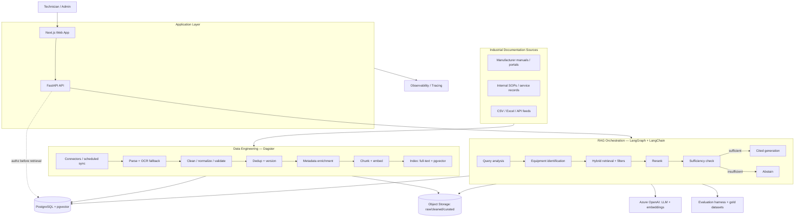
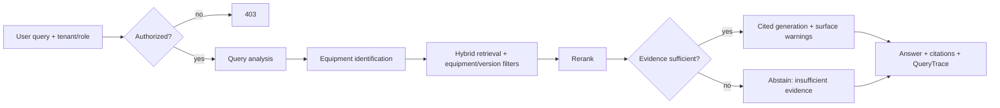

# Industrial Knowledge Intelligence Platform (IKIP) — Architecture Document

_BMAD artifact 3 of 3 — Architect output. Builds on `brief.md` and `prd.md`. Governs implementation._

---

## Introduction

This document defines the fullstack architecture for IKIP: backend services, data engineering pipeline, retrieval/RAG orchestration, web application, infrastructure and cross-cutting concerns (security, observability, testing). It is the single source of technical truth for story-driven implementation.

**Starter template:** Greenfield. No starter template; a custom monorepo is defined below to satisfy the local-first / Azure-ready constraint (NFR12, NFR17).

### Change Log

| Date       | Version | Description                                      | Author    |
| ---------- | ------- | ------------------------------------------------ | --------- |
| 2026-11-01 | 0.1     | Initial architecture from PRD (BMAD structuring) | Architect |

---

## High Level Architecture

### Technical Summary

IKIP is a modular, container-based monorepo application. A **FastAPI** backend and **Next.js** frontend sit in front of **PostgreSQL + pgvector** (metadata, full-text, vectors) and S3-compatible object storage. Two orchestration systems run side by side: **Dagster** builds and maintains the knowledge base (ingest → parse/OCR → clean → dedup → version → enrich → chunk → embed → index) as governed data assets; **LangGraph + LangChain** orchestrate the technician-facing RAG workflow (query analysis → equipment ID → hybrid retrieval → rerank → sufficiency → cited generation → abstention). All infrastructure-dependent concerns sit behind interfaces so the same business logic runs locally (MinIO/Redis/local Postgres/`.env`) and on Azure (Blob/Service Bus/Flexible Server/Key Vault/Monitor). This delivers the PRD's measurable, secure, version-aware RAG goals.

### High Level Overview

- **Architectural style:** modular services within a monorepo, deployed as containers (not microservices/K8s at MVP).
- **Repository:** monorepo (shared source local↔cloud).
- **Two pipelines, one data model:** data-engineering (Dagster, batch/scheduled) writes the knowledge base; RAG (LangGraph, request-time) reads it. They share PostgreSQL + object storage but have different execution characteristics.
- **Primary flows:** (1) a source document is ingested, processed and indexed into retrievable, citable chunks; (2) a technician question is analyzed, retrieved against with equipment/version filters, reranked, checked for sufficiency, answered with citations or abstained.
- **Separation of stores (NFR15):** raw files, cleaned content, document versions, search indexes and embeddings are logically separate so reprocessing/reindexing never destroys original evidence.

### Data Sources

Ingestion connectors (Epic 2) draw from the candidate source catalog in `data-sources.md` (51 sources across 9 categories + evaluation datasets). The **primary in-scope corpus is Category 1 — industrial equipment manuals** (Siemens, Schneider Electric, ManualLib, Metrology Manuals, Requip Market); the "Industrial Documentation Sources" node in the diagram below resolves to these. Categories 2–9 are reference / future-vertical / evaluation only and are not wired at MVP. Every source passes a license + provenance check (Story 6.5) before ingestion, and its rights are recorded on `document.rights`.

### High Level Project Diagram



### Architectural and Design Patterns

- **Ports & Adapters (Hexagonal):** core logic depends on interfaces (`ObjectStorage`, `JobQueue`, `VectorStore`, `LLMClient`, `SecretsProvider`, `Telemetry`, `Cache`, `PiiScrubber`); local and Azure/prod adapters implement them. — _Rationale: satisfies NFR12, enables local↔cloud portability and testability._
- **Repository pattern** for data access with mandatory tenant scoping. — _Rationale: centralizes tenant isolation (NFR10) and query logic._
- **Asset-oriented pipeline (Dagster assets):** lineage, backfills, asset-aware reprocessing. — _Rationale: FR7/FR8, NFR15._
- **Stateful graph orchestration (LangGraph):** explicit nodes, conditional branches, checkpointing, abstention edge. — _Rationale: FR14–FR18, auditable RAG._
- **Authorize-before-retrieve:** access control resolved before any retrieval or source access. — _Rationale: FR21, NFR10._
- **API versioning** under `/api/v1`. — _Rationale: FR27._

---

## Tech Stack

> This is the definitive, single-source technology selection. Versions are pinned at implementation start (lockfiles in repo); use latest stable within the stated major unless a story says otherwise.

| Category            | Technology                                                   | Role / Notes                                        |
| ------------------- | ------------------------------------------------------------ | --------------------------------------------------- |
| Language (backend)  | Python 3.12+                                                 | Backend + services                                  |
| Language (frontend) | TypeScript                                                   | Web app                                             |
| Backend framework   | FastAPI + Pydantic v2                                        | REST APIs, validation                               |
| Frontend framework  | Next.js (App Router) + React                                 | Technician/admin UI                                 |
| Database            | PostgreSQL 16 + pgvector                                     | Metadata, full-text (BM25-style), vectors           |
| Migrations          | Alembic                                                      | Safe, reversible migrations (NFR13)                 |
| Data orchestration  | Dagster                                                      | Knowledge-base pipeline, assets, schedules, sensors |
| RAG orchestration   | LangGraph + LangChain                                        | Stateful technician-facing workflow                 |
| Async / queue       | Redis (local) → Azure Service Bus                           | `JobQueue` interface                              |
| Object storage      | MinIO (local) → Azure Blob                                  | `ObjectStorage` interface                         |
| PDF processing      | Per-page router: PyMuPDF · OCR · Docling (`docling-serve`) | `TextExtractor` port (ADR 0021/0024); `IKIP_PDF_EXTRACTOR=hybrid` |
| OCR                 | Indra (default, ONNX CPU) · Tesseract (fallback)           | `OcrEngine` seam (ADR 0024); Indra weights OpenRAIL-M — see Story 6.5 |
| Office / HTML       | DOCX·PPTX·XLSX → Docling · HTML/text → text-first          | Format routed by magic bytes/content-type in `curate_document` |
| Data validation     | Pydantic + Pandera                                           | Content/quality validation (FR... Story 2.4)        |
| LLM + embeddings    | Azure OpenAI via `LLMClient` adapter                       | Pluggable provider                                  |
| Tracing / eval      | OpenTelemetry + (optional) LangSmith; pytest                 | `query_trace`, groundedness/citation eval         |
| Observability       | Prometheus + Grafana (local) → Azure Monitor + App Insights | `Telemetry` interface                             |
| Auth                | Local dev accounts / OIDC → Microsoft Entra ID              | Tenant + role in token                              |
| Secrets             | `.env` (local) → Azure Key Vault + managed identities     | `SecretsProvider` interface                       |
| Containerization    | Docker + Docker Compose                                      | Local dev (NFR17)                                   |
| Deployment target   | Azure Container Apps                                         | API, web, workers                                   |
| Container registry  | Azure Container Registry                                     | Images                                              |
| IaC                 | Terraform                                                    | dev/staging/prod (NFR13)                            |
| CI/CD               | GitHub Actions                                               | Quality + security + safety gates (NFR14)           |
| Testing             | pytest, Playwright, k6 (perf)                                | Unit/integration/retrieval/security/perf            |

> **Deliberately excluded at MVP (add only when justified):** Kubernetes/AKS, Azure AI Search, dedicated managed Redis, provisioned-throughput LLM, always-on GPU, large Document Intelligence bills.

> **Vector store rationale:** PostgreSQL + pgvector is chosen over a dedicated vector DB (Qdrant) or managed search (Azure AI Search) because IKIP's retrieval is hybrid-and-relational (vector + full-text + equipment/version filters + tenant/document ACL in one query), keeps tenant isolation and versioning/deletion transactional in one system, and preserves local↔cloud parity at MVP scale. Retrieval sits behind the `VectorStore` interface, so switching stores later is a planned adapter swap. Full decision, trade-offs and revisit triggers: [ADR 0001](./adr/0001-vector-store-pgvector.md).

---

## Data Models

Canonical entities (fields summarized; full column definitions live in migrations). Every tenant-owned entity carries `tenant_id` and is tenant-scoped by the repository layer.

| Entity                            | Key fields                                                            | Relationships                        |
| --------------------------------- | --------------------------------------------------------------------- | ------------------------------------ |
| **Tenant**                  | id, name, configuration, policies                                     | 1—N User, Document, Equipment       |
| **User**                    | id, tenant_id, role, account_status                                   | N—1 Tenant                          |
| **Equipment**               | id, tenant_id, manufacturer, model, version/revision, asset_id        | N—M Document                        |
| **Document**                | id, tenant_id, title, source, type, rights/license                    | 1—N DocumentVersion; N—M Equipment |
| **DocumentVersion**         | id, document_id, revision, publication_date, effective_date, checksum | 1—N Section                         |
| **Section**                 | id, document_version_id, hierarchy, heading, page_range               | 1—N Chunk                           |
| **Chunk**                   | id, section_id, content, page_range, metadata                         | 1—1 Embedding                       |
| **Embedding**               | id, chunk_id, model_version, vector (pgvector)                        | N—1 Chunk                           |
| **IngestionJob**            | id, tenant_id, source, state, timestamps, error_info                  | —                                   |
| **QueryTrace**              | id, tenant_id, user_id, retrieval_ids, model, latency, cost           | —                                   |
| **EvaluationCase**          | id, dataset, question, relevant_evidence, expected_behavior           | —                                   |
| **AuditEvent**              | id, tenant_id, actor, operation, resource, timestamp                  | —                                   |
| **Conversation / Feedback** | id, tenant_id, user_id, messages, citations, rating, flags            | N—1 User                            |

**Design rule:** raw files, cleaned content, `DocumentVersion`, search index, and `Embedding` are stored so any one can be rebuilt from upstream without losing the others (NFR15).

---

## Components

| Component                        | Responsibility                                                             | Depends on                                            |
| -------------------------------- | -------------------------------------------------------------------------- | ----------------------------------------------------- |
| `apps/api` (FastAPI)           | REST surface, auth, authorization, tenant scoping, orchestrates RAG + jobs | repositories, interfaces, RAG service                 |
| `apps/web` (Next.js)           | Search, chat, document viewer, admin, dashboards                           | `apps/api`                                          |
| `services/ingestion`           | Connectors, scheduled sync, raw capture                                    | `ObjectStorage`, `JobQueue`, Dagster              |
| `services/document-processing` | Parse, OCR fallback, clean, validate, dedup, version, enrich               | `ObjectStorage`, Dagster, PyMuPDF/Docling/Tesseract |
| `services/indexing`            | Chunking, embeddings, full-text + vector index                             | `VectorStore`, `LLMClient`, PostgreSQL            |
| `services/retrieval`           | BM25 + vector + hybrid + rerank + filters + LangGraph RAG                  | `VectorStore`, `LLMClient`, repositories          |
| `services/evaluation`          | Gold datasets, Recall@K, citation/groundedness/safety eval                 | retrieval, datasets                                   |
| `packages/common`              | Shared models, interfaces, tenant utilities                                | —                                                    |
| `packages/ai-clients`          | Pluggable LLM/embedding adapters                                           | Azure OpenAI                                          |

---

## Core Workflows

**Ingestion (Dagster, batch):** connector → raw stored in object storage + `IngestionJob` created → parse/OCR (two-stage) → clean/normalize/validate → dedup → create/supersede `DocumentVersion` → enrich metadata → chunk into `Section`/`Chunk` → embed (`Embedding`) → index (full-text + pgvector) → lineage + quality report. Failures → dead-letter + retry; reprocessing via asset-aware re-run.

**RAG (LangGraph, request-time):**



Authorization is resolved before retrieval; traces (`QueryTrace`) capture retrieval IDs, model, latency and cost.

---

## Database Schema (notes)

- PostgreSQL 16; `pgvector` extension for `embedding.vector` with an appropriate index (e.g., HNSW/IVFFlat) chosen during Story 3.2/3.3.
- Full-text search via `tsvector`/GIN on curated content for the lexical path.
- Every tenant-owned table: `tenant_id` column + composite indexes beginning with `tenant_id`.
- Soft-delete/version supersession preserves original evidence (NFR15); hard deletion only via the retention/deletion workflow (Story 6.5).

---

## Source Tree

```
ikip/
├── apps/
│   ├── web/                  # Next.js frontend
│   └── api/                  # FastAPI backend
├── services/
│   ├── ingestion/
│   ├── document-processing/
│   ├── indexing/
│   ├── retrieval/
│   └── evaluation/
├── packages/
│   ├── common/               # shared models, interfaces, tenant utils
│   └── ai-clients/           # pluggable LLM/embedding adapters
├── infrastructure/
│   ├── docker/compose.yaml
│   └── terraform/{modules,environments/{dev,staging,prod}}
├── tests/{unit,integration,retrieval,security,performance}
├── datasets/evaluation/
├── .github/workflows/
└── docs/
```

---

## Infrastructure and Deployment

- **Local:** Docker Compose runs web, api, Postgres+pgvector, MinIO, Redis, Dagster; only LLM/embedding calls are remote (NFR17).
- **Azure:** Container Apps (api/web/workers + Container Apps Jobs for Dagster-triggered batch), PostgreSQL Flexible Server, Blob Storage, Service Bus, ACR, Key Vault, Azure Monitor/App Insights. Region: France Central or West Europe (confirm model availability/data residency).
- **IaC:** Terraform modules per environment; secrets via Key Vault + managed identities.
- **CI/CD:** GitHub Actions → build, test, scan → staging → production; gates (quality + security + safety) required; safe reversible migrations; documented rollback.
- **Cost control:** two-stage document processing; PostgreSQL hybrid retrieval before any managed search; no always-on GPU/K8s at MVP.

---

## Error Handling Strategy

- Ingestion: retries with backoff; dead-letter path; errors recorded on `IngestionJob`; quality report surfaces failures.
- API: consistent error envelope; validation errors via Pydantic; auth/authz errors as 401/403 with no tenant leakage.
- RAG: on insufficient evidence → abstain (not error); on tool/retrieval failure → safe fallback + trace.
- All errors structured-logged and traced (OpenTelemetry); no secrets/PII in logs.

---

## Coding Standards

- Python: type hints + Pydantic models at boundaries; ruff/black; services depend on interfaces from `packages/common`, never on Azure SDKs directly.
- TypeScript: strict mode; shared API types generated from OpenAPI where possible.
- Tenant scoping is enforced in the repository layer — no raw cross-tenant queries.
- ADRs recorded for significant decisions.
- Retrieved document content is always treated as untrusted (prompt-injection posture).

---

## Test Strategy

Full pyramid + specialized suites (mirrors `tests/`):

- **Unit** — logic, repositories (incl. tenant scoping).
- **Integration** — API + DB + storage + queue.
- **Retrieval** — Recall@K, ranking, citation resolution on gold datasets (regression-gated).
- **Security** — tenant isolation (zero cross-tenant disclosure), authorize-before-retrieve, prompt-injection/malicious-document.
- **Safety** — 100% pass on critical safety-abstention set (release-blocking).
- **Performance** — p95 retrieval < 1.5 s, p95 TTFT < 5 s under defined load (k6).
  CI enforces all gates before deploy (NFR14).

---

## Security

- **Tenant isolation:** `tenant_id` scoping + object-level permissions on chunks/sources; automated cross-tenant tests are a CI gate.
- **Authorize-before-retrieve:** access resolved prior to retrieval and source access (FR21).
- **AuthN/Z:** OIDC/Entra ID; role-based; reusable authorization dependency.
- **Encryption:** TLS in transit; encryption at rest; secrets via Key Vault + managed identities; secrets/PII never logged.
- **Prompt injection / malicious docs:** retrieved content untrusted; restricted tool access; adversarial CI tests.
- **Governance:** licensing/provenance tracking; per-tenant retention; consistent deletion across raw/curated/index/embedding stores; audit logging of sensitive actions.
- **Threat model** maintained in `docs/` with each threat mapped to a control and a test (Story 6.1).

---

## Next Steps

1. Validate architecture against the BMAD architect checklist.
2. ✅ Sharded: `prd.md` → [`prd/`](./prd/index.md) (per-epic); this document → [`architecture/`](./architecture/index.md) (per-section). Significant decisions recorded in [`adr/`](./adr/README.md).
3. Begin Epic 1 story-by-story (SM → Dev), honoring these standards and the PRD acceptance criteria.
