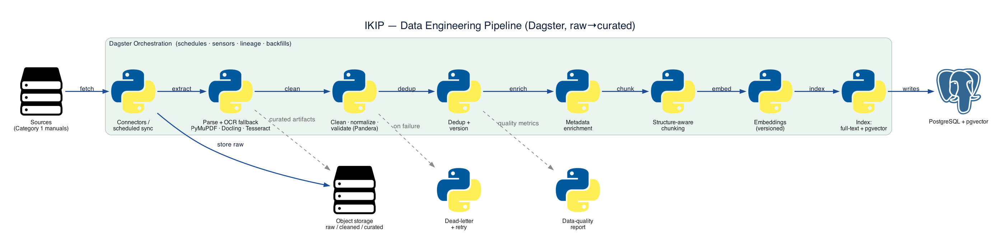
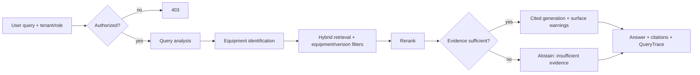
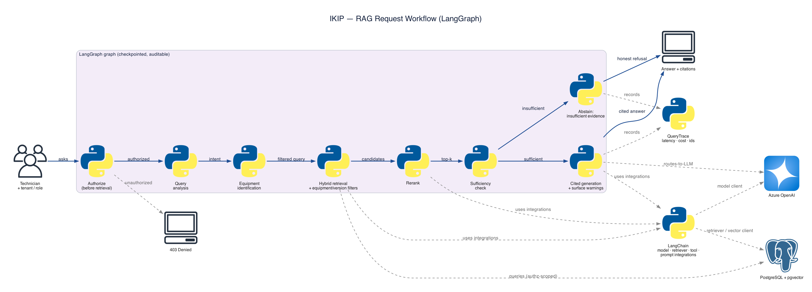

# Core Workflows

_Sharded from `../architecture.md`. Part of the [architecture index](./index.md)._

**Ingestion (Dagster, batch):** connector → raw stored in object storage + `IngestionJob` created → parse/OCR (two-stage) → clean/normalize/validate → dedup → create/supersede `DocumentVersion` → enrich metadata → chunk into `Section`/`Chunk` → embed (`Embedding`) → index (full-text + pgvector) → lineage + quality report. Failures → dead-letter + retry; reprocessing via asset-aware re-run. See [ADR 0002](../adr/0002-dual-orchestration-dagster-langgraph.md).

> Generated as code (`diagrams/02_ingestion_pipeline.py`). Solid = principal flow; dashed = backing dependency.

**RAG (LangGraph, request-time):**

> Generated as code (`diagrams/03_rag_workflow.py`). Solid = principal flow; dashed = backing dependency.

Authorization is resolved before retrieval; traces (`QueryTrace`) capture retrieval IDs, model, latency and cost.
