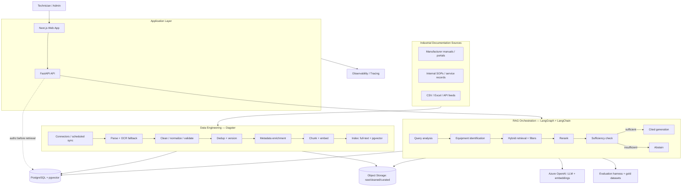
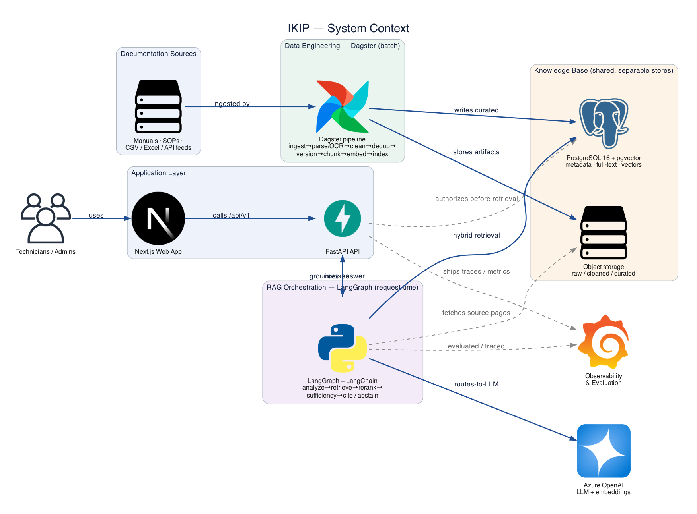

# High Level Architecture

_Sharded from `../architecture.md`. Part of the [architecture index](./index.md)._

## Technical Summary

IKIP is a modular, container-based monorepo application. A **FastAPI** backend and **Next.js** frontend sit in front of **PostgreSQL + pgvector** (metadata, full-text, vectors) and S3-compatible object storage. Two orchestration systems run side by side: **Dagster** builds and maintains the knowledge base (ingest → parse/OCR → clean → dedup → version → enrich → chunk → embed → index) as governed data assets; **LangGraph + LangChain** orchestrate the technician-facing RAG workflow (query analysis → equipment ID → hybrid retrieval → rerank → sufficiency → cited generation → abstention). All infrastructure-dependent concerns sit behind interfaces so the same business logic runs locally (MinIO/Redis/local Postgres/`.env`) and on Azure (Blob/Service Bus/Flexible Server/Key Vault/Monitor). This delivers the PRD's measurable, secure, version-aware RAG goals.

## High Level Overview

- **Architectural style:** modular services within a monorepo, deployed as containers (not microservices/K8s at MVP). — see [ADR 0005](../adr/0005-managed-containers-not-kubernetes.md), [ADR 0006](../adr/0006-monorepo.md)
- **Repository:** monorepo (shared source local↔cloud). — see [ADR 0006](../adr/0006-monorepo.md)
- **Two pipelines, one data model:** data-engineering (Dagster, batch/scheduled) writes the knowledge base; RAG (LangGraph, request-time) reads it. They share PostgreSQL + object storage but have different execution characteristics. — see [ADR 0002](../adr/0002-dual-orchestration-dagster-langgraph.md)
- **Primary flows:** (1) a source document is ingested, processed and indexed into retrievable, citable chunks; (2) a technician question is analyzed, retrieved against with equipment/version filters, reranked, checked for sufficiency, answered with citations or abstained.
- **Separation of stores (NFR15):** raw files, cleaned content, document versions, search indexes and embeddings are logically separate so reprocessing/reindexing never destroys original evidence.

## Data Sources

Ingestion connectors (Epic 2) draw from the candidate source catalog in [`../data-sources.md`](../data-sources.md) (51 sources across 9 categories + evaluation datasets). The **primary in-scope corpus is Category 1 — industrial equipment manuals** (Siemens, Schneider Electric, ManualLib, Metrology Manuals, Requip Market); the "Industrial Documentation Sources" node in the diagram below resolves to these. Categories 2–9 are reference / future-vertical / evaluation only and are not wired at MVP. Every source passes a license + provenance check (Story 6.5) before ingestion, and its rights are recorded on `document.rights`.

## High Level Project Diagram

### Rendered System Context

> Generated as code (`diagrams/01_system_context.py`). **Solid dark-blue = principal flow; dashed grey = backing dependency.** See [`diagrams/README.md`](./diagrams/README.md).

## Architectural and Design Patterns

- **Ports & Adapters (Hexagonal):** core logic depends on interfaces (`ObjectStorage`, `JobQueue`, `VectorStore`, `LLMClient`, `SecretsProvider`, `Telemetry`, `Cache`, `PiiScrubber`); local and Azure/prod adapters implement them. — _Rationale: satisfies NFR12, enables local↔cloud portability and testability._ See [ADR 0003](../adr/0003-local-first-ports-and-adapters.md).
- **Repository pattern** for data access with mandatory tenant scoping. — _Rationale: centralizes tenant isolation (NFR10) and query logic._
- **Asset-oriented pipeline (Dagster assets):** lineage, backfills, asset-aware reprocessing. — _Rationale: FR7/FR8, NFR15._ See [ADR 0002](../adr/0002-dual-orchestration-dagster-langgraph.md).
- **Stateful graph orchestration (LangGraph):** explicit nodes, conditional branches, checkpointing, abstention edge. — _Rationale: FR14–FR18, auditable RAG._ See [ADR 0002](../adr/0002-dual-orchestration-dagster-langgraph.md).
- **Authorize-before-retrieve:** access control resolved before any retrieval or source access. — _Rationale: FR21, NFR10._
- **API versioning** under `/api/v1`. — _Rationale: FR27._
