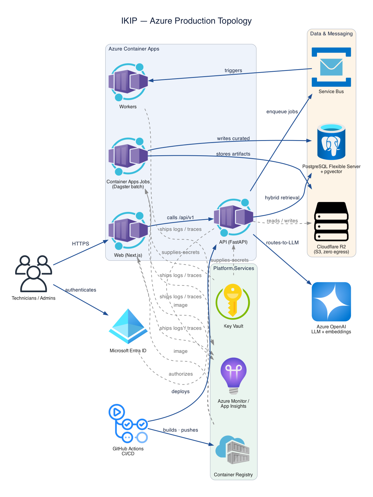
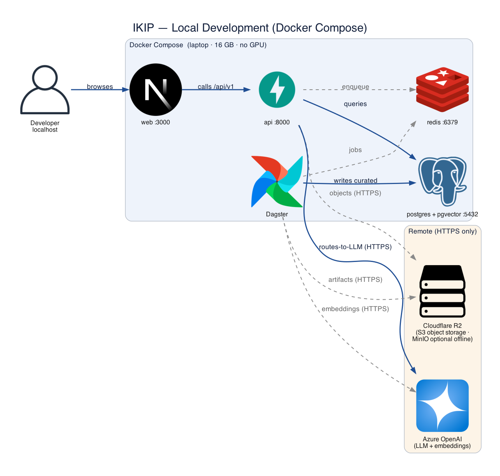

# Infrastructure and Deployment

_Sharded from `../architecture.md`. Part of the [architecture index](./index.md)._

- **Dev workflow (local-first; cloud for models only):** the full stack runs locally; only LLM/embedding calls are remote (Azure OpenAI / Foundry) — a capable local model would need a GPU not assumed here. Azure is used at **deployment** time for cloud learning (IaC, identity, Key Vault, Cost Management). See [ADR 0012](../adr/0012-local-first-dev-cloud-models-only.md) (supersedes [ADR 0011](../adr/0011-cloud-first-hybrid-dev-workflow.md)); the cost runbook [`runbooks/dev-on-azure-cost-control.md`](../../runbooks/dev-on-azure-cost-control.md) applies to the staging/prod phase.
- **Local:** Docker Compose runs web, api, Postgres+pgvector, Redis, Dagster; object storage is **Cloudflare R2** (S3-compatible) — or local **MinIO** for offline tests. AI (LLM/embedding) calls and R2 are remote (NFR17, [ADR 0014](../adr/0014-cloudflare-r2-object-storage.md)).
- **Azure:** Container Apps (api/web/workers + Container Apps Jobs for Dagster-triggered batch), PostgreSQL Flexible Server, Service Bus, ACR, Key Vault, Azure Monitor/App Insights. **Object storage: Cloudflare R2** (not Azure Blob — zero egress, S3-compatible; [ADR 0014](../adr/0014-cloudflare-r2-object-storage.md)). Region: France Central or West Europe (confirm model availability/data residency; R2 residency noted as a revisit trigger in ADR 0014).
- **IaC:** Terraform modules per environment; secrets via Key Vault + managed identities.
- **CI/CD:** GitHub Actions → build, test, scan → staging → production; gates (quality + security + safety) required; safe reversible migrations; documented rollback.
- **Cost control:** two-stage document processing; PostgreSQL hybrid retrieval before any managed search; no always-on GPU/K8s at MVP.

> Runtime-platform rationale: [ADR 0005](../adr/0005-managed-containers-not-kubernetes.md) (Container Apps over Kubernetes). Local↔cloud portability: [ADR 0003](../adr/0003-local-first-ports-and-adapters.md). Implemented by Epic 6 (Stories 6.6, 6.7, 6.8).

## Azure Production Topology

> Generated as code (`diagrams/04_azure_deployment.py`). Solid = principal flow; dashed = backing dependency.

## Local Development Topology

> Generated as code (`diagrams/05_local_dev.py`). Only AI calls are remote (NFR17). Solid = principal flow; dashed = backing dependency.
