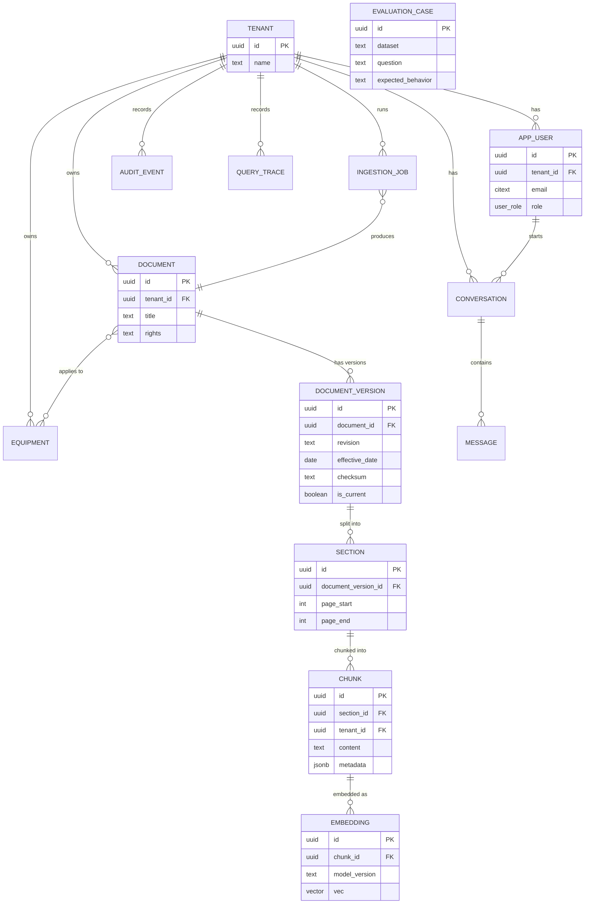

# LLD — Data Schema & ERD

_Physical PostgreSQL 16 + pgvector schema that makes the entity-level [data model](../data-models.md) concrete. Design artifact; the authoritative version becomes Alembic migrations at implementation (Story 1.5, 2.x, 3.x). Unblocks Epics 1–3._

Design rules applied (from HLD / ADRs):
- Every tenant-owned table carries `tenant_id`, and composite indexes **lead** with `tenant_id` (NFR10, tenant isolation).
- Raw/cleaned/version/index/embedding are **separable** (NFR15): original evidence is never destroyed by reprocessing; hard delete only via retention workflow (Story 6.5).
- UUID primary keys; `created_at/updated_at timestamptz`; JSONB for open metadata.
- Vector search via `pgvector` ([ADR 0001](../../adr/0001-vector-store-pgvector.md)); lexical via `tsvector`/GIN ([ADR 0004](../../adr/0004-hybrid-retrieval-on-postgres.md)).

## ERD



## DDL (design)

> Column set is indicative; types/constraints finalize in migrations. `vector(1536)` assumes an `text-embedding-3-small`-class model — the dimension is **model-dependent** and set when the embedding model is chosen (Story 3.2).

```sql
CREATE EXTENSION IF NOT EXISTS vector;
CREATE EXTENSION IF NOT EXISTS citext;

CREATE TYPE user_role        AS ENUM ('admin','manager','technician');
CREATE TYPE account_status   AS ENUM ('active','suspended');
CREATE TYPE ingestion_state  AS ENUM ('pending','running','succeeded','failed','dead_letter');
CREATE TYPE message_role     AS ENUM ('user','assistant');

-- ── Tenancy & identity ───────────────────────────────────────────────
CREATE TABLE tenant (
  id            uuid PRIMARY KEY DEFAULT gen_random_uuid(),
  name          text NOT NULL,
  configuration jsonb NOT NULL DEFAULT '{}',
  policies      jsonb NOT NULL DEFAULT '{}',
  created_at    timestamptz NOT NULL DEFAULT now(),
  updated_at    timestamptz NOT NULL DEFAULT now()
);

CREATE TABLE app_user (
  id             uuid PRIMARY KEY DEFAULT gen_random_uuid(),
  tenant_id      uuid NOT NULL REFERENCES tenant(id) ON DELETE CASCADE,
  email          citext NOT NULL,
  role           user_role NOT NULL DEFAULT 'technician',
  account_status account_status NOT NULL DEFAULT 'active',
  created_at     timestamptz NOT NULL DEFAULT now(),
  updated_at     timestamptz NOT NULL DEFAULT now(),
  UNIQUE (tenant_id, email)
);

-- ── Equipment catalog ────────────────────────────────────────────────
CREATE TABLE equipment (
  id           uuid PRIMARY KEY DEFAULT gen_random_uuid(),
  tenant_id    uuid NOT NULL REFERENCES tenant(id) ON DELETE CASCADE,
  manufacturer text NOT NULL,
  model        text NOT NULL,
  revision     text,
  asset_id     text,
  created_at   timestamptz NOT NULL DEFAULT now()
);
CREATE INDEX ix_equipment_tenant_model ON equipment (tenant_id, manufacturer, model, revision);

-- ── Documents, versions, associations ────────────────────────────────
CREATE TABLE document (
  id         uuid PRIMARY KEY DEFAULT gen_random_uuid(),
  tenant_id  uuid NOT NULL REFERENCES tenant(id) ON DELETE CASCADE,
  title      text NOT NULL,
  source     text,
  type       text,
  rights     text,                       -- license / provenance (Story 6.5)
  created_at timestamptz NOT NULL DEFAULT now()
);
CREATE INDEX ix_document_tenant ON document (tenant_id);

CREATE TABLE document_version (
  id               uuid PRIMARY KEY DEFAULT gen_random_uuid(),
  document_id      uuid NOT NULL REFERENCES document(id) ON DELETE CASCADE,
  revision         text NOT NULL,
  publication_date date,
  effective_date   date,
  checksum         text NOT NULL,        -- dedup (Story 2.5)
  is_current       boolean NOT NULL DEFAULT true,  -- version-aware retrieval (FR14)
  created_at       timestamptz NOT NULL DEFAULT now(),
  UNIQUE (document_id, revision)
);
CREATE INDEX ix_docver_doc_effective ON document_version (document_id, effective_date DESC);

CREATE TABLE document_equipment (          -- N:M
  document_id  uuid NOT NULL REFERENCES document(id) ON DELETE CASCADE,
  equipment_id uuid NOT NULL REFERENCES equipment(id) ON DELETE CASCADE,
  PRIMARY KEY (document_id, equipment_id)
);

-- ── Sections, chunks, embeddings ─────────────────────────────────────
CREATE TABLE section (
  id                  uuid PRIMARY KEY DEFAULT gen_random_uuid(),
  document_version_id uuid NOT NULL REFERENCES document_version(id) ON DELETE CASCADE,
  parent_section_id   uuid REFERENCES section(id) ON DELETE CASCADE,
  heading             text,
  hierarchy_path      text,              -- e.g. '3.2.1'
  page_start          int,
  page_end            int,
  ordinal             int NOT NULL DEFAULT 0
);
CREATE INDEX ix_section_docver ON section (document_version_id);

CREATE TABLE chunk (
  id          uuid PRIMARY KEY DEFAULT gen_random_uuid(),
  section_id  uuid NOT NULL REFERENCES section(id) ON DELETE CASCADE,
  tenant_id   uuid NOT NULL REFERENCES tenant(id) ON DELETE CASCADE,  -- denormalized for scoped queries
  content     text NOT NULL,
  page_start  int,
  page_end    int,
  token_count int,
  metadata    jsonb NOT NULL DEFAULT '{}',
  tsv         tsvector GENERATED ALWAYS AS (to_tsvector('simple', content)) STORED,
  created_at  timestamptz NOT NULL DEFAULT now()
);
CREATE INDEX ix_chunk_tenant      ON chunk (tenant_id);
CREATE INDEX ix_chunk_tsv         ON chunk USING gin (tsv);              -- lexical (ADR 0004)

CREATE TABLE embedding (
  id            uuid PRIMARY KEY DEFAULT gen_random_uuid(),
  chunk_id      uuid NOT NULL REFERENCES chunk(id) ON DELETE CASCADE,
  model_version text NOT NULL,
  vector        vector(1536) NOT NULL,
  created_at    timestamptz NOT NULL DEFAULT now(),
  UNIQUE (chunk_id, model_version)         -- re-embed without destroying prior (Story 3.2)
);
CREATE INDEX ix_embedding_hnsw ON embedding
  USING hnsw (vector vector_cosine_ops);   -- ANN (ADR 0001)

-- ── Operations: jobs, traces, audit, eval ────────────────────────────
CREATE TABLE ingestion_job (
  id          uuid PRIMARY KEY DEFAULT gen_random_uuid(),
  tenant_id   uuid NOT NULL REFERENCES tenant(id) ON DELETE CASCADE,
  source      text NOT NULL,
  state       ingestion_state NOT NULL DEFAULT 'pending',
  document_id uuid REFERENCES document(id) ON DELETE SET NULL,
  attempts    int NOT NULL DEFAULT 0,
  error_info  jsonb,
  started_at  timestamptz,
  finished_at timestamptz,
  created_at  timestamptz NOT NULL DEFAULT now()
);
CREATE INDEX ix_job_tenant_state ON ingestion_job (tenant_id, state);

CREATE TABLE query_trace (
  id            uuid PRIMARY KEY DEFAULT gen_random_uuid(),
  tenant_id     uuid NOT NULL REFERENCES tenant(id) ON DELETE CASCADE,
  user_id       uuid REFERENCES app_user(id) ON DELETE SET NULL,
  question      text,
  retrieval_ids uuid[],                   -- chunk ids used
  model         text,
  latency_ms    int,
  cost_usd      numeric(10,6),
  abstained     boolean NOT NULL DEFAULT false,
  created_at    timestamptz NOT NULL DEFAULT now()
);
CREATE INDEX ix_trace_tenant_time ON query_trace (tenant_id, created_at DESC);

CREATE TABLE conversation (
  id         uuid PRIMARY KEY DEFAULT gen_random_uuid(),
  tenant_id  uuid NOT NULL REFERENCES tenant(id) ON DELETE CASCADE,
  user_id    uuid NOT NULL REFERENCES app_user(id) ON DELETE CASCADE,
  created_at timestamptz NOT NULL DEFAULT now()
);

CREATE TABLE message (
  id              uuid PRIMARY KEY DEFAULT gen_random_uuid(),
  conversation_id uuid NOT NULL REFERENCES conversation(id) ON DELETE CASCADE,
  role            message_role NOT NULL,
  content         text NOT NULL,
  citations       jsonb NOT NULL DEFAULT '[]',  -- [{document_version_id,page,section_id}]
  rating          smallint,                     -- user feedback (FR26)
  flagged         boolean NOT NULL DEFAULT false,
  created_at      timestamptz NOT NULL DEFAULT now()
);
CREATE INDEX ix_message_conversation ON message (conversation_id);

CREATE TABLE audit_event (
  id            uuid PRIMARY KEY DEFAULT gen_random_uuid(),
  tenant_id     uuid NOT NULL REFERENCES tenant(id) ON DELETE CASCADE,
  actor_user_id uuid REFERENCES app_user(id) ON DELETE SET NULL,
  operation     text NOT NULL,
  resource_type text,
  resource_id   uuid,
  metadata      jsonb NOT NULL DEFAULT '{}',
  created_at    timestamptz NOT NULL DEFAULT now()
);
CREATE INDEX ix_audit_tenant_time ON audit_event (tenant_id, created_at DESC);

CREATE TABLE evaluation_case (            -- NOT tenant-owned (shared gold datasets)
  id                uuid PRIMARY KEY DEFAULT gen_random_uuid(),
  dataset           text NOT NULL,        -- e.g. 'outdated-manuals','conflicting','tables','safety'
  question          text NOT NULL,
  relevant_evidence jsonb NOT NULL DEFAULT '[]',
  expected_behavior text,                 -- e.g. 'answer' | 'abstain'
  created_at        timestamptz NOT NULL DEFAULT now()
);
```

## Notes
- **Tenant scoping** is enforced in the repository layer (not just FKs); `chunk.tenant_id` is denormalized so retrieval filters never need a multi-join just to scope.
- **HNSW vs IVFFlat** and HNSW build params (`m`, `ef_construction`) are tuned in Story 3.3 — that's inside-the-box LLD, deferred.
- **Full-text config** (`simple` vs language-specific, multilingual) is revisited if non-English corpora are added.
- **Deletion** cascades model reprocessing safely, but *hard* deletes for data-rights run through the retention workflow (Story 6.5), which also removes object-storage artifacts and embeddings consistently.
