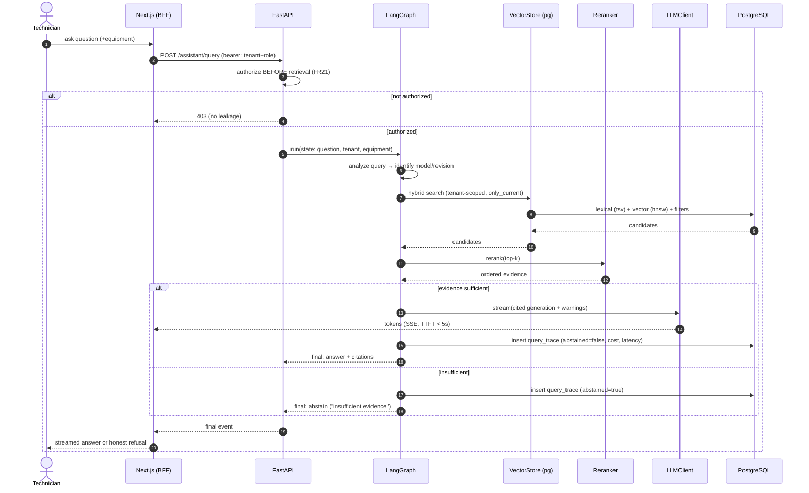

# LLD — Sequence Diagrams

_Call-level flows for the two core workflows, below the topology diagrams in [`../img/`](../img). Design artifact; actual calls finalize per story. Complements [core-workflows.md](../core-workflows.md)._

## 1. Ingestion (Dagster, batch) — one document, raw→indexed

```mermaid
sequenceDiagram
    autonumber
    participant SRC as Source connector
    participant DAG as Dagster (assets)
    participant OBJ as ObjectStorage
    participant PROC as document-processing
    participant IDX as indexing
    participant LLM as LLMClient (embeddings)
    participant PG as PostgreSQL + pgvector

    SRC->>DAG: new/changed document (sensor/schedule)
    DAG->>PG: INSERT ingestion_job (state=pending)
    DAG->>OBJ: put(raw/…)  (store original)
    DAG->>PROC: parse + OCR fallback (two-stage)
    alt extraction quality OK
        PROC->>OBJ: put(curated/…)
        PROC->>PG: upsert document_version (dedup by checksum; supersede prior)
        PROC->>PG: insert sections
        DAG->>IDX: chunk sections
        IDX->>LLM: embed(chunks, model_version)
        LLM-->>IDX: vectors
        IDX->>PG: insert chunk (tsv) + embedding (hnsw)
        DAG->>PG: UPDATE ingestion_job (state=succeeded)
    else extraction fails / low quality
        PROC->>PG: UPDATE ingestion_job (state=failed, error_info)
        DAG->>DAG: retry w/ backoff → dead_letter
    end
    DAG->>PG: write lineage + data-quality report
```

Key points: raw is stored **before** processing (evidence preserved, NFR15); a new revision **supersedes** via `is_current` without deleting the old (FR14); failures dead-letter and are reprocessable (Story 2.6).

## 2. RAG query (LangGraph, request-time) — authorize → answer / abstain



Key points: authorization is resolved **before** any retrieval/source access; retrieval is tenant-scoped and version-aware; the graph takes the **abstention branch** rather than inventing content (FR17); every run writes a `query_trace` (FR30) — answered *or* abstained.

> These are design-level sequences. Exact node boundaries, retry edges, and the sufficiency threshold are inside-the-box LLD, finalized in Stories 3.4/3.5 and tuned against the evaluation sets (Epic 5).
